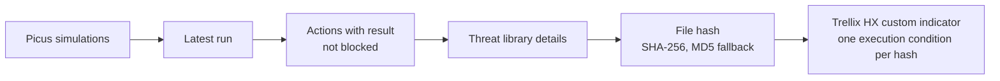

# Picus ↔ Trellix HX Integration

[](https://github.com/AtakanUk/picus-hx-integration/actions/workflows/ci.yml)

[](LICENSE)

Closes the loop between breach-and-attack simulation and endpoint protection, and adds two HX lookups used during incident triage.

## Deny-list sync

Picus runs real malware samples against the endpoints. Each sample the EDR did **not** block is a proven gap. Blocking its hash is the cheapest fix while detection content is tuned.



- Hashes are found anywhere in the action detail, because the field names differ between threat types. Only well-formed MD5/SHA-1/SHA-256 values are accepted, so nothing else can ever end up in a block rule.
- Hashes are de-duplicated across simulations. HX answers `409` for a hash that is already in the indicator, and it is reported as `duplicate`.
- A simulation or action that cannot be read is logged and skipped; the rest of the run continues.
- `DRY_RUN=true` reads everything and writes nothing.

```bash
picus-hx denylist-sync                        # all simulations
picus-hx denylist-sync --simulation-id 101    # selected ones
```

## Host lookup

```bash
picus-hx host-lookup --hostname WS-042
picus-hx host-lookup --ip-address 192.0.2.42 --incident 2101
```

This prints a readable summary of the endpoint: OS and kernel, agent version, containment state, alert statistics, last alert, last poll time and IP, first check-in. With `--incident`, the summary is written into a rich-text field of the SOAR incident (`--field`, default `hx_host_details`), so the analyst sees it without opening the HX console. IP lookups search first and then load the full host record.

## File-name search

```bash
picus-hx filename-search --filename invoice_2026.exe
```

This starts an HX enterprise search over the configured host set (`HX_HOST_SET_ID`), useful for scoping how far a dropped file has spread.

## Configuration

| Variable | Description |
| --- | --- |
| `PICUS_API_BASE_URL`, `PICUS_REFRESH_TOKEN` | Picus API (refresh token is exchanged for an access token) |
| `HX_BASE_URL`, `HX_USERNAME`, `HX_PASSWORD` | HX appliance; token authentication via `X-FeApi-Token` |
| `HX_INDICATOR_CATEGORY`, `HX_INDICATOR_NAME` | Indicator that holds the deny list |
| `HX_HOST_SET_ID` | Host set for enterprise searches |
| `DRY_RUN` | No writes to HX |
| `SOAR_*` | Only for `host-lookup --incident` |

## Installation and tests

```bash
pip install -e .
pip install pytest
pytest
```

## License

[MIT](LICENSE)
